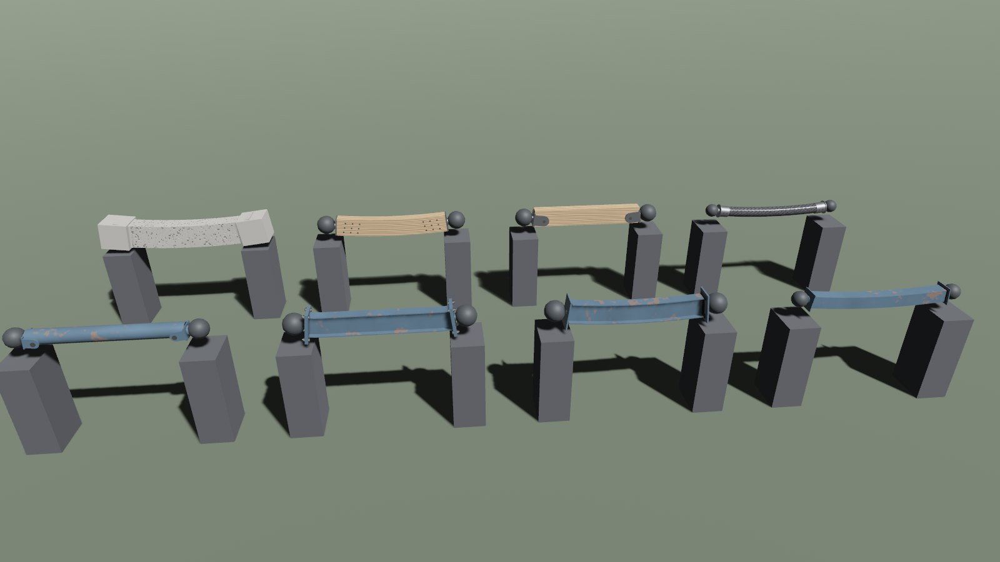
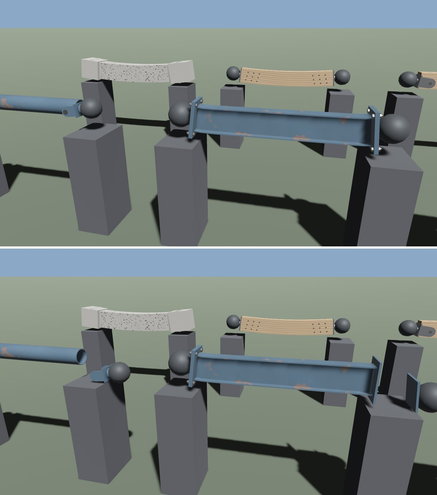
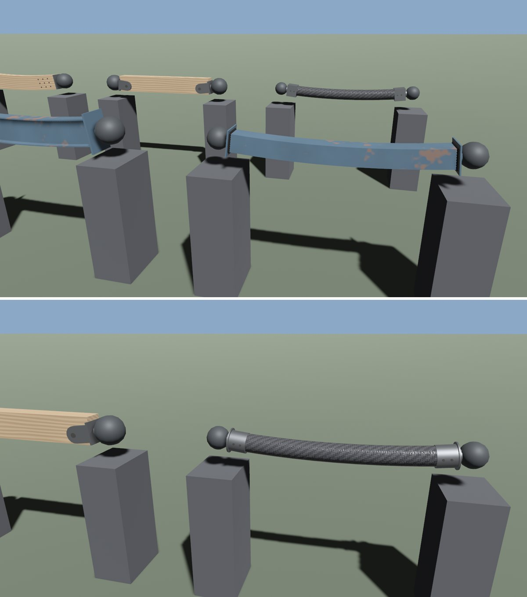

# Member visuals: deformation, damage and breaking

Two crates draw the structure the solver computes:

- `crates/breakit-mesh` (no engine): profiles, template meshes, the pose maths, the fracture surface, the visual scene driver, debris and particles. Everything is testable headless.
- `crates/breakit-render` (Bevy, same pin as the game): the plugin, the member shader `src/member.wesl`, debris and particle drawing, and the examples.

## The idea

A polygon mesh is only slow if the CPU has to touch its vertices. Here it never does.

1. **Members are recipes.** A member is a `Profile` (rect, round, tube, box, I-beam), a length, a material kind and a seed. `Profile::section()` gives the solver its section from the same numbers, so what is drawn is what is computed.
2. **One template mesh per profile.** `member_template` builds it once in member space: position = (s, y, z), s from 0 to 1 along the member. Every member with that profile is an instance of it, and Bevy batches them into one draw.
3. **The vertex shader bends it.** Each instance reads a 176-byte `GpuMember` record (end positions, end frames, elastic end tangents, hinge stubs, damage, fracture window) from one storage buffer, indexed by its `MeshTag`. The centreline is the cubic Hermite curve through the end nodes with the beam's end tangents, which is the exact deflected shape of an Euler-Bernoulli beam without span loads. Plastic hinges are straight stubs that follow the node, then a crease.
4. **Detail is procedural in the fragment shader.** Painted steel with flaking at yield lines, timber grain and splits, concrete with cracks and spalling, carbon twill with whitening and ply splits, all driven by the solver's `MemberDamage` values. No textures to author or regenerate.
5. **A break is not a re-mesh.** The two halves keep drawing the same template, each clamped to its side of a per-material fracture surface (`cut.rs`, mirrored in the shader): a necked tear for steel, fibre bundles of different lengths for timber, a rough face plus a crushed gap and exposed bars for concrete, stepped and splayed plies for composites. The halves stay attached to their nodes, spring back and ring for a moment (`scene.rs`, `Remnant`), then follow the node rigidly. Loose chunks become cheap visual-only rigid bodies, with sparks, dust, splinters and fibres as particles.

Per frame the CPU writes one record per member and nothing else. Intact members use a lean template; a member switches to a detailed one (more vertices across the section and along the member) only when it breaks.

## Numbers

`cargo run --release -p breakit-mesh --example visual_bench`, one thread of a 2.3 GHz Xeon, steel tube template (642 vertices):

| members | GPU path, CPU ms per frame | upload | bending the polygons on the CPU instead | upload |
|--------:|---------------------------:|-------:|----------------------------------------:|-------:|
| 1,000   | 0.08 | 171 KB | 36 ms  | 15 MB  |
| 5,000   | 0.41 | 859 KB | 172 ms | 75 MB  |
| 20,000  | 1.54 | 3.4 MB | 673 ms | 300 MB |

A break costs about 0.2 ms once (halves, rebar, chunks, particles).

Not measured yet: GPU frame time on real hardware. The container only has a software rasteriser, which runs the 473-member collapse at about 4 fps and says nothing about a GPU. Run `cargo run --release -p breakit-render --example stress -- 320` (about 5,100 members) on a real machine; it prints fps and the CPU split once a second. Add `--no-sim` to time rendering without the solver.

## Joints and nodes

Members are drawn with their real connections (`breakit-mesh/src/joint.rs`, `breakit-render/src/joints.rs`). `VisualStructure::with_joints(looks)` takes one `JointLook` per member end; `with_joints_from(&structure)` reads them off the solver model, and `StructureVisual::jointed` does that for the game. Without joints nothing changes: members run node to node.

| `JointLook` | drawn | goes when the connection fails |
|---|---|---|
| `Pinned` | clevis on the node, pin through the member end | the pin |
| `Bolted` | end plate on the member, matching plate on the node, bolts | the bolts |
| `Welded` | member butted on a node plate, a rippled fillet round the section outline | the weld |
| `Monolithic` | concrete haunch into a cast block | nothing, the member decides |
| `Dowelled` | steel plate in a slot in the timber, a staggered dowel group | the dowels |
| `Sleeve` | steel shoe round the member end, two through-bolts | the bolts |

`JointLook::of(kind, material)` maps the solver's `JointKind`; a `Rigid` joint is drawn as whatever makes one in that material (weld, cast node, shoe). `JointLook::infer(&joint, material)` does the same from a `Joint`'s numbers when the kind is not known.

How it works:

- **Hubs.** Every node a joint meets gets a hub (cast steel ball, or a concrete block where only monolithic members meet), sized to the largest section there (`node_radius`).
- **Trim.** Each jointed member end stops `trim` metres short of the node. That is only the member's `clip` window in its `GpuMember`, so it costs nothing and the template is untouched.
- **Two rigid parts per joint.** One follows the node, one follows the member's own curve where it is cut (`joint_pose`). A pin visibly turns in its clevis and a yielding end plate opens away from its partner. Pinned ends are also posed properly now: the member leaves a pin with no curvature instead of following the node's rotation.
- **Shared meshes.** Parts are built once per (look, profile, trim) in joint space and every joint of that kind is an entity with the same mesh and material, so Bevy instances them. Per frame the CPU writes one transform per part (about four per member).
- **Connection failure.** A `BreakCause::Connection` break at a jointed end does not tear the member: its fuse parts disappear with a small burst, and the member comes away whole, hanging from its other node (`JointState::failed`). Elsewhere, and for members without joints, breaks work as before, with the hardware staying on each half.

`cargo run --release -p breakit-render --example joints [-- --view a|c|d]` shows every joint; two of them fail one second in.





## Using it from the game

```rust
app.add_plugins(BreakitRenderPlugin);
// When the design changes:
commands.insert_resource(StructureVisual::jointed(&structure, &styles));
// Each frame after BreakitSet::Physics:
frame.0 = visual.frame_from_sim(&sim);                    // simulate
frame.0 = visual.frame_from_positions(&positions, &util); // build
```

`RenderSettings { stress_view, highlighted }` switches to the utilisation heatmap and highlights members. `RenderStats` reports slot, debris and particle counts and the CPU time of the visual update.

## Examples

- `gallery`: every material intact, damaged and breaking, from a synthetic frame.
- `joints`: every connection close up, loaded, and two failing.
- `stress`: a long mixed-material truss on the real solver, loaded until it collapses.

Both take `--capture <dir> [--at t1,t2,...] [--view close]` for headless screenshots under `xvfb-run -a`. Headless needs `mesa-vulkan-drivers` and `libxkbcommon-x11-0`.

## Keeping CPU and shader in step

`MemberPose::deform` and `cut::cut_offset` are the reference for `bend` and `cut_offset` in `member.wesl`. `GpuMember` mirrors the shader's `Member` struct field for field. Change them together.

## Open points

- A member freed by a failed connection hangs rigidly from its other node, even when that end is a pin; it should swing or fall as a loose body.
- Hubs are one size per node and do not know about supports; base plates and bearings at supports are not drawn yet.
- Joint hardware keeps its paint in the stress view.

- Nodes land on the ground and table (`docs/contact.md`), but broken halves hang rigidly from their node and can poke into the ground.
- Each debris chunk has its own mesh (not instanced). Fine at the default cap of 2,000 pieces; pre-generate a chunk library if that ever shows up in a profile.
- No level of detail yet. A third, coarser template for distant members is a small change in `sync_instances`.
- Joints (gusset plates, bolts, node hubs) are not drawn; the game still draws its node spheres.
- Remnants do not sag or swing after they settle; they are rigid on their node.
- Tuning the looks was done on a software rasteriser. Colours and bump strength want a pass on a real GPU.
